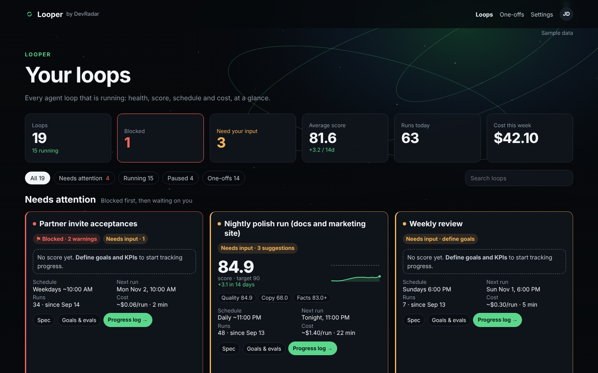
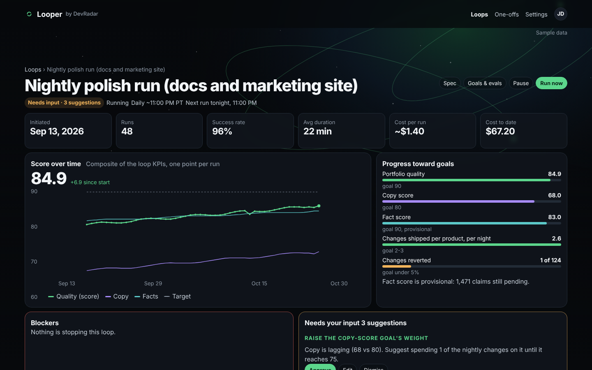
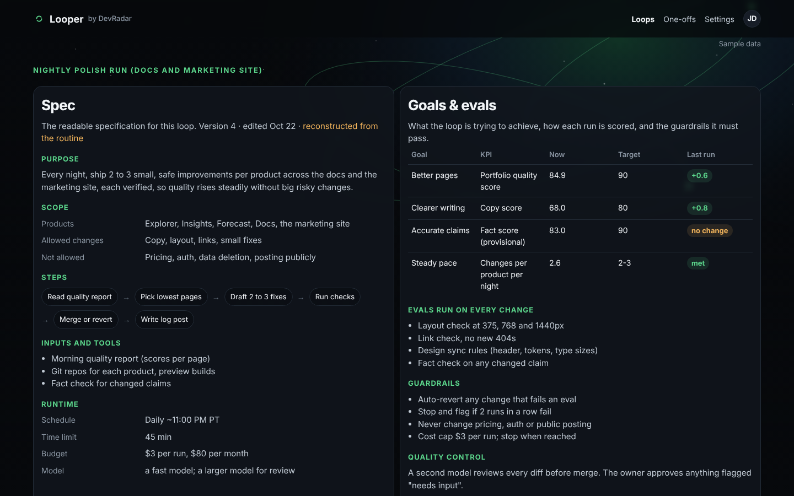
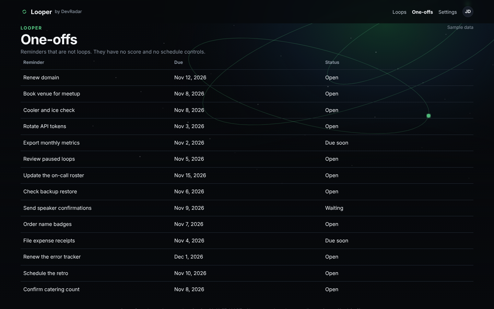
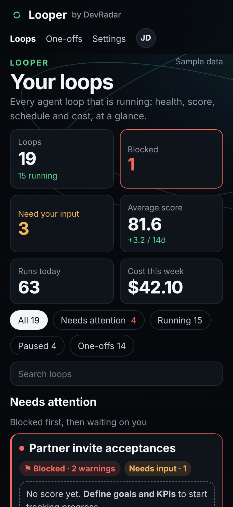
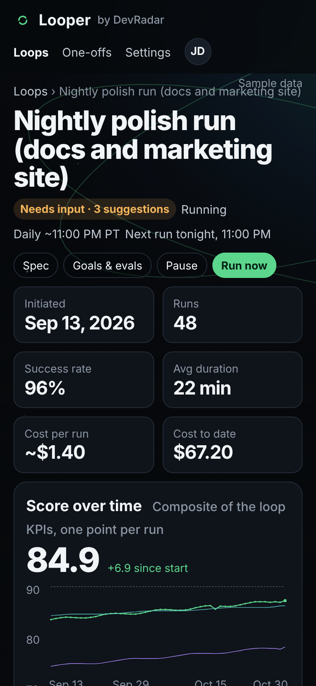

<p align="center"></p>

<h1 align="center">Looper</h1>

<p align="center">Set up and see your looping, scheduled processes in one dashboard: the steps that power each one, and the KPIs that move it toward its objectives.</p>

<p align="center"></p>

## What it shows

Each loop is a recurring agent job, like a nightly docs cleanup or a weekly metrics email, described in one Markdown spec.

- **Dashboard.** Every loop with its health, score, schedule and cost, plus anything blocked or waiting on you.
- **Loop page.** The score over time against its target, progress toward each goal, blockers, and a log of every run.
- **Spec and goals.** The objective, the KPIs and OKRs it is measured against, and the steps the loop follows.
- **One-offs.** Reminders that are not loops, with due dates.

<table>
  <tr>
    <td width="50%"><br>Loop and score</td>
    <td width="50%"><br>Spec and goals</td>
  </tr>
  <tr>
    <td width="50%"><br>One-offs</td>
    <td width="50%" align="center"> <br>On a phone</td>
  </tr>
</table>

Screenshots show sample data.

## Run it

```bash
npm install
npm run dev        # http://localhost:3000
```

For production, `npm run build` then `npm start` (listens on `PORT`, default 3000). The app makes no network calls at runtime.

## Your own loops

By default Looper shows the sample loops in `fixtures/`. To point it at your own:

```bash
LOOPER_DATA_MODE=private LOOPER_DATA_DIR=/path/to/loops npm start
```

`LOOPER_DATA_DIR` is a folder with:

- one `*.md` file per loop: YAML front matter (`id`, `name`, `routine_id`, `status`, `schedule`, `owner`, `created`, `last_run`, `prompt_source`, `kpis`, `okrs`) and the sections Objective, Evaluation and measurement, Sources and instructions, Quality control, Roadmap, and Run history and notes;
- `status.json` with `generated_at`, an entry per loop (`enabled`, `last_run`, `result`, `next_run`, `kpis`) and `one_offs`;
- optionally `runs/<loop-id>.jsonl`, one run per line.

`README.md`, `EDIT-PROTOCOL.md` and files starting with `_` are skipped. A loop's score is the weighted average of its KPIs, each scaled 0 to 100 against its target. A loop with goals set to `none defined yet` has no score and shows as needing input. The full file format is on the `/spec` page.

## Pages

| Route | Page |
|---|---|
| `/` | Home |
| `/spec` | The loop spec format |
| `/looper` | Dashboard |
| `/looper/{id}` | One loop |
| `/looper/{id}/spec` | Its spec and goals |
| `/looper/{id}/runs/{n}` | One run |
| `/looper/one-offs` | One-offs |

## Scripts

| Command | Does |
|---|---|
| `npm run dev` | Local server |
| `npm run build` / `npm start` | Production build and server |
| `npm run lint` / `npm run typecheck` | ESLint and `tsc --noEmit` |
| `npm test` | Vitest |
| `npm run fixtures` | Regenerates `fixtures/` from `scripts/build-fixtures.mjs` |

Built by Rex St. John.
